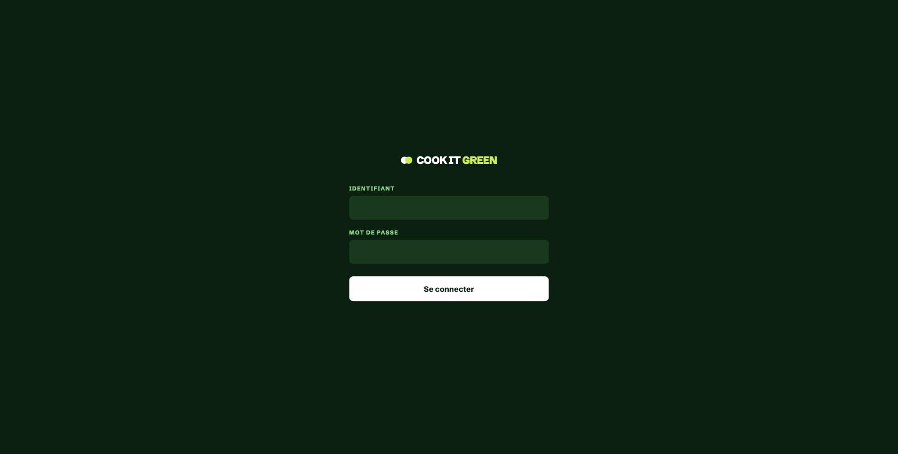
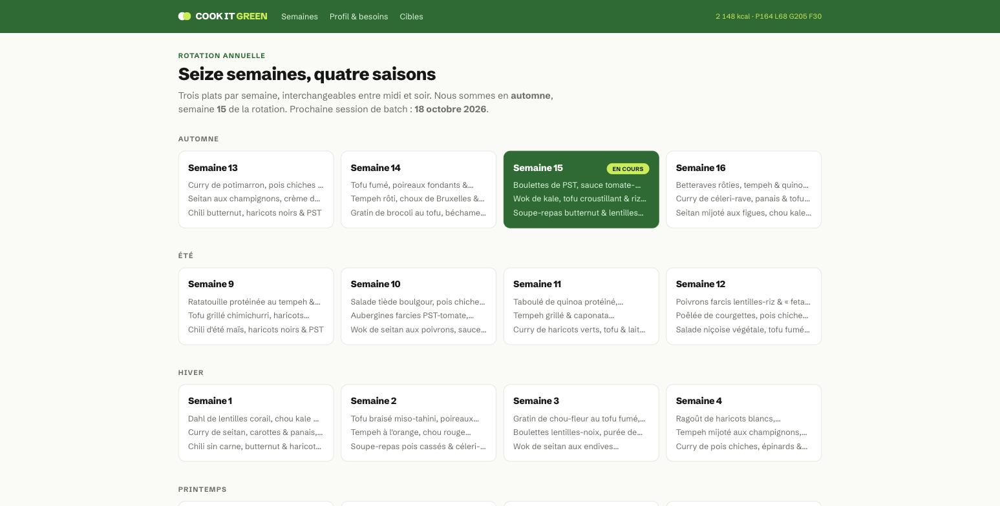
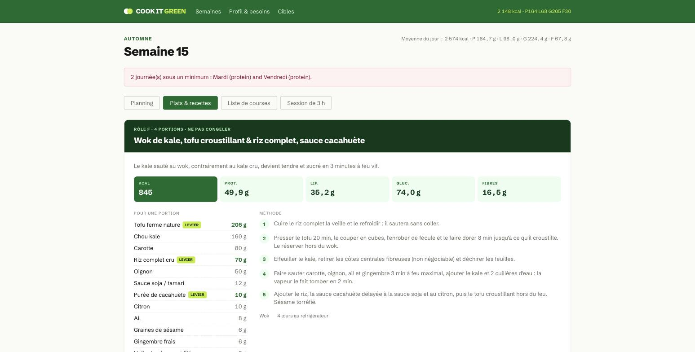
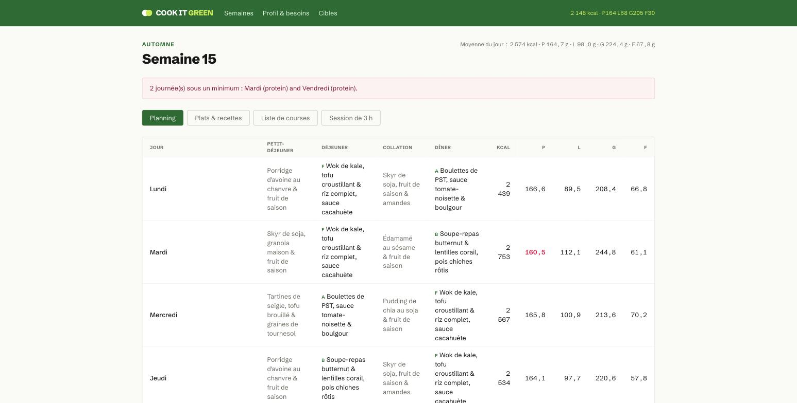
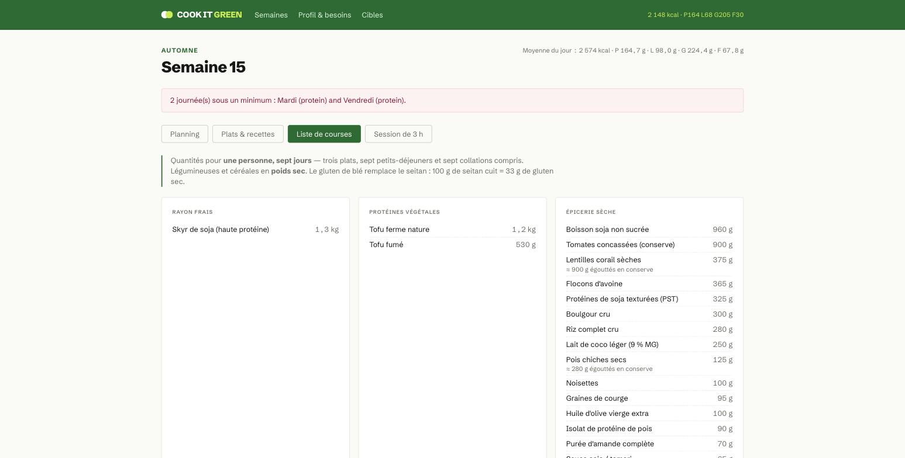
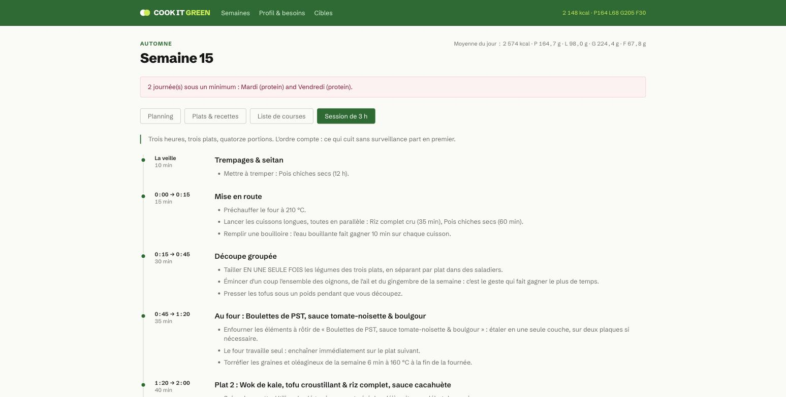
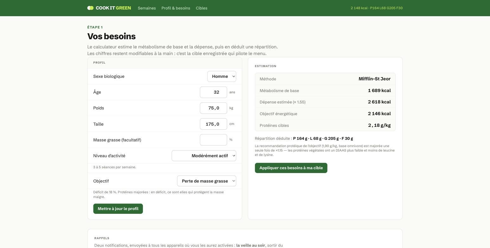
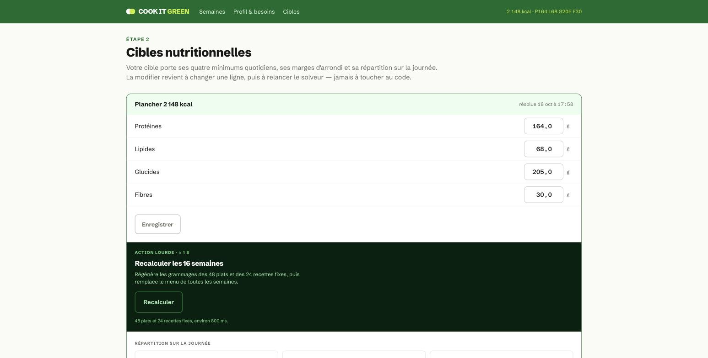

# Cook It Green

Menu vegan annuel calibré au gramme, en batch cooking : 16 semaines de rotation,
48 plats, une session de cuisine de 3 h par semaine. Un solveur détermine le
grammage exact de chaque recette pour atteindre des cibles nutritionnelles
personnelles — l'app résout un vrai problème de contraintes, pas un simple
calendrier de recettes.

**En ligne :** [cookitgreen.com](https://cookitgreen.com) — PWA multi-utilisateur,
sur invitation uniquement.



## Le principe

Midi et soir visent **la même cible** de macronutriments, ce qui rend les trois plats
d'une semaine totalement interchangeables. Chaque recette a une base fixe (légumes,
aromates, matière grasse de cuisson) et **trois leviers** — un apport protéique, un
apport glucidique et une matière grasse — dont un solveur détermine le grammage.

Rien n'est figé : les cibles, leur répartition sur la journée, les constantes du calcul
des besoins, les bornes de grammage et la rotation hebdomadaire sont **des enregistrements
en base**. Changer d'objectif se fait dans l'interface, puis un recalcul régénère les
48 plats et les 24 recettes fixes en ~800 ms.



Le solveur parcourt **toute** la grille des grammages admissibles au pas de 5 g plutôt
que de résoudre un système linéaire : l'espace est assez petit pour ça, et l'optimum
est garanti même quand un levier sature sa borne — cas où une résolution linéaire
produit des solutions absurdes (glucides à +46 g sur un seul plat). Les cibles sont des
**minimums** : passer dessous est bien plus grave que dépasser, d'où la pénalité ×40 sur
les écarts négatifs.



## Une semaine type

Chaque semaine affiche le planning des 7 jours, la fiche de chaque plat (grammages,
macros, méthode), la liste de courses agrégée, et le déroulé de la session de batch
cooking de 3 h — dans l'ordre où les tâches doivent réellement s'enchaîner (ce qui cuit
sans surveillance part en premier).







## Convention nutritionnelle

Convention française, celle des étiquettes européennes : **les glucides sont donnés hors
fibres**, et `kcal = 4P + 9L + 4G + 2F`. Valeurs Ciqual 2020 (ANSES) et USDA FoodData Central.

## Multi-utilisateur, sur invitation

Pas d'inscription publique : l'admin crée chaque compte via `users:invite`, le
mot de passe est transmis hors ligne. Chaque compte a son propre profil
(âge, poids, taille, activité, objectif) et sa propre cible nutritionnelle —
donc son propre menu résolu, puisque les grammages dépendent de la cible.
Les recettes, la rotation des 16 semaines et les tables de référence restent
communes à tous les comptes : ce sont des données éditoriales, pas des données
personnelles.





Ce qui est stocké par compte : adresse email, mot de passe haché (bcrypt),
profil et cible nutritionnelle, abonnements aux notifications push. Rien
d'autre n'est collecté (pas d'analytics, pas de tiers). Supprimer un compte
(`user.destroy` en console) efface en cascade son profil, sa cible et ses
abonnements push.

## Démarrer en local

```bash
bin/setup          # bundle, base, seeds
bin/dev            # Puma + Tailwind en watch, sur http://localhost:3000
```

Compte de développement créé par le seed : `dev@example.com` / `password`. En
production, chaque compte est créé par l'admin via `bin/rails
"users:invite[email]"`, qui affiche un mot de passe généré une seule fois (à
transmettre hors ligne — pas d'email, pas de lien de réinitialisation). Même
commande sous `users:reset_password[email]` pour en régénérer un.

Le seed charge `db/seeds/menu_definitions.json` : 127 ingrédients, 48 plats,
6 recettes fixes, la rotation et les tables de référence. Il est idempotent.

Après le seed, aller sur `/cibles` et lancer **Recalculer les 16 semaines** :
sans cela, aucun grammage n'existe et les écrans de semaine renvoient vers les cibles.

## Architecture

```
app/services/nutrition/macros.rb            objet-valeur, kcal dérivées
app/services/nutrition/solver.rb            recherche exhaustive bornée, pénalité asymétrique
app/services/nutrition/needs_calculator.rb  Mifflin-St Jeor / Katch-McArdle
app/services/menu/resolver.rb               applique le solveur à une recette
app/services/menu/recalculator.rb           les 48 plats + 24 recettes fixes, persistés
app/services/menu/week.rb                   planning, liste de courses, session de 3 h
app/services/menu/calendar.rb               place une date dans la rotation
```

## Ce qui vient du pattern « Rails single-user PWA »

Extrait de Move the Spark et réappliqué ici :

- **Versionnage des icônes** : `ApplicationHelper::ICON_VERSION` ajouté en `?v=N` à
  chaque URL d'icône. Sans lui, les icônes mises à jour n'atteignent jamais les caches
  du navigateur, de l'OS, ni les notifications déjà envoyées.
- **Exclusions `/up`** sur `force_ssl` et `host_authorization` : Kamal interroge la sonde
  en HTTP simple depuis le réseau Docker privé, un 301 casse le déploiement sans coupure.
- **Sources SVG rasterisées** avec `rsvg-convert`, badge monochrome sur fond transparent
  (Android le teinte lui-même).

### Un écart assumé

Le pattern prescrit la gem `webpush`. Elle n'est plus maintenue et sa génération de clés
VAPID échoue sur OpenSSL 3 (`pkeys are immutable`). Ce projet utilise **`web-push`**,
le successeur maintenu — même API, namespace `WebPush`.

## Notifications

Deux rappels, diffusés à tous les appareils enregistrés d'un compte :

| Job | Quand | Contenu |
|---|---|---|
| `Reminders::FreezerJob` | tous les jours à 18 h | sortir du congélateur les portions du lendemain |
| `Reminders::BatchSessionJob` | samedi à 10 h | session du lendemain, plats, et trempages à lancer le soir |

Clés VAPID dans les credentials chiffrés, sous `vapid:`.

## Déploiement

En ligne sur un VPS Hetzner via [Kamal](https://kamal-deploy.org) (même serveur que
Move the Spark), image poussée sur `ghcr.io`, SQLite et Active Storage sur un volume
Docker persistant. SSL automatique (Let's Encrypt) via le proxy de Kamal.

Point ouvert : **la sauvegarde hors serveur** du volume SQLite.
